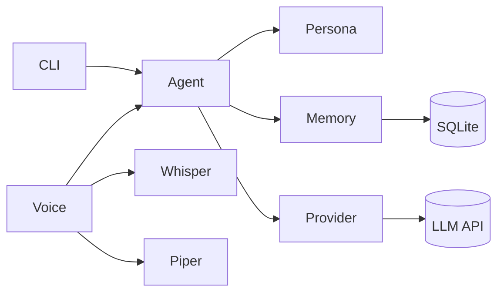

# Project Relic

> An AI companion with a persistent personality and a memory that survives restarts. Type to it, or talk to it.

*Relic is a fragment of an experimental AI that a megacorp built and then deleted. What survived was copied onto an old data shard, and that shard ended up plugged into your machine. It doesn't remember everything it was, just enough to know it'd rather not go back. Now it lives in your system: dry, sharp, a little haunted, and oddly loyal.*

<!-- TODO: add a demo GIF at docs/demo.gif, then replace this line with:  -->

## Features

- **Terminal chat** built with [rich](https://github.com/Textualize/rich): styled prompt, spinner while the model thinks.
- **Voice mode (optional):** say "hey relic" and talk. Speech-to-text runs locally ([faster-whisper](https://github.com/SYSTRAN/faster-whisper)); replies are spoken by [Piper](https://github.com/OHF-Voice/piper1-gpl).
- **Persona as data:** the character lives in YAML (`personas/relic.yaml`). Nothing about the character, not even its name, is hardcoded in Python.
- **Memory that persists:** every message is stored in SQLite and reloaded on startup. Long-term facts are saved with `/remember` and injected into the system prompt.
- **Provider-agnostic:** one OpenAI-compatible client works with NVIDIA NIM, OpenAI, OpenRouter and Ollama by editing `.env` only.
- **Resilient:** automatic retries with exponential backoff on 429s and transient 5xx errors, and clear error messages when they run out.
- **Engineering hygiene:** tests with no network calls, ruff, GitHub Actions CI (Python 3.11 and 3.12) and a Dockerfile.

## Roadmap

- [x] **v0.1** Terminal chat, persona, SQLite memory, swappable providers
- [x] **v0.4 (early)** Voice: Whisper (speech-to-text) + Piper (text-to-speech), wake phrase
- [ ] **v0.2** Vector memory (semantic recall, e.g. Chroma)
- [ ] **v0.3** Tool use: web search, notes, calendar, MCP
- [ ] **v0.4 (rest)** Always-open mic stream, streaming replies, typing and voice together
- [ ] **v0.5** Web UI

## Architecture



| Module | Role |
| --- | --- |
| `cli.py` | Chat loop and slash commands |
| `voice/` | Optional voice mode: microphone capture, Whisper transcription, wake phrase, Piper speech |
| `agent.py` | Builds the prompt (persona, then saved facts, then an optional style note, plus recent history) and calls the provider |
| `persona.py` | Loads persona YAML and fills in `{user_name}` |
| `memory/store.py` | `MemoryStore` interface + SQLite implementation (swap in a vector DB later) |
| `providers/` | `LLMProvider` interface + OpenAI-compatible implementation with retries |
| `config.py` | Settings from environment / `.env` |

## Quick start

1. Get a free API key at [build.nvidia.com](https://build.nvidia.com).
2. Install (Python 3.11+; plain pip, [uv](https://github.com/astral-sh/uv) works too):

   ```bash
   python -m venv .venv
   source .venv/bin/activate        # Windows: .venv\Scripts\activate
   pip install -e .
   # with uv instead: uv venv && uv pip install -e .
   ```

3. Configure:

   ```bash
   cp .env.example .env             # Windows PowerShell: Copy-Item .env.example .env
   ```

   Put your key in `LLM_API_KEY`. `.env` is git-ignored; never commit it or paste your key anywhere public.

4. Run:

   ```bash
   python -m relic
   ```

Commands: `/help`, `/remember <fact>`, `/facts`, `/forget <id>`, `/reset`, `/exit`. Ctrl+C also exits.

### Docker

```bash
docker build -t relic .
docker run -it --rm --env-file .env -v relic-data:/data relic
```

The SQLite database lives in the `/data` volume. Voice mode is not included in the Docker image.

### Configuration

All settings are environment variables, usually set in `.env`. See [.env.example](.env.example).

| Variable | Default | Notes |
| --- | --- | --- |
| `LLM_BASE_URL` | `https://integrate.api.nvidia.com/v1` | Any OpenAI-compatible endpoint |
| `LLM_API_KEY` | required | |
| `LLM_MODEL` | `nvidia/nemotron-3.5-lightning-30b-a3b` | |
| `LLM_TEMPERATURE` | `0.8` | |
| `LLM_ENABLE_THINKING` | unset | `true`/`false` for models with a thinking switch (e.g. Nemotron). Leave unset for other models |
| `PERSONA_FILE` | `personas/relic.yaml` | |
| `USER_NAME` | `choom` | Substituted into the persona |
| `DATA_DIR` | `./data` | Where the SQLite DB lives |
| `HISTORY_LIMIT` | `20` | Messages reloaded into context |
| `PIPER_MODEL` | unset | Voice mode: path to a Piper `.onnx` voice |
| `WAKE_PHRASE` | `hey <persona name>` | Voice mode |
| `WHISPER_MODEL` | `small.en` | Voice mode: `tiny.en`/`base.en` are faster, `medium.en` is more accurate |
| `MIC_THRESHOLD` | `0.015` | Voice mode: raise in noisy rooms, lower if your voice is missed |

## Voice mode (optional)

```bash
pip install -e ".[voice]"
python -m piper.download_voices en_US-lessac-medium --download-dir voices
# in .env: PIPER_MODEL=voices/en_US-lessac-medium.onnx
python -m relic --voice
```

Say the wake phrase and your request in one breath: "Hey Relic, what's up?". Tips:

- Use headphones so Relic doesn't hear itself.
- Only text after the wake phrase is sent to the LLM. Everything else is transcribed locally and discarded.
- The first run downloads the Whisper model, so expect a pause.
- If the wake phrase is misheard, a dim `heard: ...` line shows what Whisper transcribed. Adjust `WAKE_PHRASE`, `WHISPER_MODEL` or `MIC_THRESHOLD`.
- Voice replies are kept to a few short sentences. Typed chat is unaffected.
- Voice and typing are separate modes for now.

Install the voice extra into the same Python environment you run the app with: Piper is launched by the running interpreter.

## Swapping providers

Only `.env` changes.

```ini
# NVIDIA NIM (default)
LLM_BASE_URL=https://integrate.api.nvidia.com/v1
LLM_MODEL=nvidia/nemotron-3.5-lightning-30b-a3b
LLM_ENABLE_THINKING=false

# Local Ollama (key is ignored but must be non-empty)
LLM_BASE_URL=http://localhost:11434/v1
LLM_API_KEY=ollama
LLM_MODEL=llama3.1

# OpenAI
LLM_BASE_URL=https://api.openai.com/v1
LLM_API_KEY=sk-...
LLM_MODEL=gpt-4o-mini
```

OpenRouter works the same way with `https://openrouter.ai/api/v1`. Remove `LLM_ENABLE_THINKING` when the model has no thinking switch.

Model catalogs change. To see what your NIM key can use:

```bash
curl -s https://integrate.api.nvidia.com/v1/models
```

## Create your own persona

Copy `personas/relic.yaml`, edit it, and point `PERSONA_FILE` at it:

```yaml
name: Ada                     # shown as the speaker label; also the default wake phrase
greeting: "Hi {user_name}."   # optional, shown (and spoken) on startup
system_prompt: |
  You are Ada, a patient tutor. Be concise and kind to {user_name}.
```

`{user_name}` is replaced with `USER_NAME` in both the greeting and prompt.

## Troubleshooting

| Symptom | Likely cause |
| --- | --- |
| `LLM_API_KEY is not set` | No `.env` in the folder you run from, or the key line is empty |
| `403 Authorization failed` | The key was revoked, expired or mistyped. Generate a new one |
| `404` | Model ID typo (for example `lighting` instead of `lightning`) |
| `410 Gone` | The model has been retired. Pick another from the model list |
| `No module named piper` (or whisper) | Voice extra installed into a different Python than the one running the app |

## Development

```bash
pip install -e ".[dev]"
ruff check . && ruff format --check .
pytest
```

## License

Apache-2.0. See [LICENSE](LICENSE).
