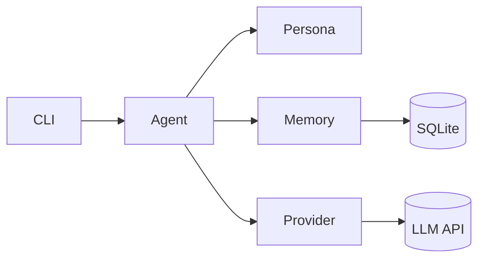

# Project Relic

> A terminal AI companion with a persistent personality and a memory that survives restarts.

*Relic is a fragment of an experimental AI that a megacorp built and then deleted. What survived was copied onto an old data shard, and that shard ended up plugged into your machine. It doesn't remember everything it was, just enough to know it'd rather not go back. Now it lives in your system: dry, sharp, a little haunted, and oddly loyal.*

<!-- TODO: add demo GIF -->


## Features (v0.1)

- Terminal chat UI built with [rich](https://github.com/Textualize/rich): styled prompt, spinner while the model thinks.
- Character defined entirely in YAML (`personas/relic.yaml`); nothing about the character is hardcoded in Python.
- Conversation history stored in SQLite and reloaded on startup, so chats continue across sessions.
- Long-term facts: `/remember`, `/facts`, `/forget`, injected into the system prompt.
- Provider-agnostic: one OpenAI-compatible client works with NVIDIA NIM, OpenAI, OpenRouter and Ollama by editing `.env` only.
- Automatic retries with exponential backoff on 429s and transient 5xx errors.
- Tests (no network), ruff, GitHub Actions CI and a Dockerfile.

## Roadmap

- **v0.2** Vector memory (semantic recall, e.g. Chroma)
- **v0.3** Tool use: web search, notes, calendar, MCP
- **v0.4** Voice: Whisper (speech-to-text) + Piper (text-to-speech)
- **v0.5** Web UI

## Architecture



| Module | Role |
| --- | --- |
| `cli.py` | Chat loop and slash commands |
| `agent.py` | Builds the prompt (persona, then saved facts, then recent history) and calls the provider |
| `persona.py` | Loads persona YAML and fills in `{user_name}` |
| `memory/store.py` | `MemoryStore` interface + SQLite implementation (swap in a vector DB later) |
| `providers/` | `LLMProvider` interface + OpenAI-compatible implementation with retries |
| `config.py` | Settings from environment / `.env` |

## Quick start

1. Get a free API key at [build.nvidia.com](https://build.nvidia.com).
2. Install (Python 3.11+; plain pip, [uv](https://github.com/astral-sh/uv) works too):

   ```bash
   python -m venv .venv
   source .venv/bin/activate        # Windows: .venv\Scripts\activate
   pip install -e .
   # with uv instead: uv venv && uv pip install -e .
   ```

3. Configure:

   ```bash
   cp .env.example .env             # then put your key in LLM_API_KEY
   ```

4. Run:

   ```bash
   python -m relic
   ```

Commands: `/help`, `/remember <fact>`, `/facts`, `/forget <id>`, `/reset`, `/exit`.

### Docker

```bash
docker build -t relic .
docker run -it --rm --env-file .env -v relic-data:/data relic
```

The SQLite database lives in the `/data` volume.

### Configuration

| Variable | Default |
| --- | --- |
| `LLM_BASE_URL` | `https://integrate.api.nvidia.com/v1` |
| `LLM_API_KEY` | required |
| `LLM_MODEL` | `nvidia/nemotron-3.5-lightning-30b-a3b` |
| `LLM_TEMPERATURE` | `0.8` |
| `LLM_ENABLE_THINKING` | unset (set `true`/`false` for models with a thinking switch, e.g. Nemotron) |
| `PERSONA_FILE` | `personas/relic.yaml` |
| `USER_NAME` | `choom` |
| `DATA_DIR` | `./data` |
| `HISTORY_LIMIT` | `20` (messages reloaded into context) |

## Voice mode (optional)

Talk to Relic with a wake phrase ("hey relic"). Speech-to-text runs locally with
[faster-whisper](https://github.com/SYSTRAN/faster-whisper); replies are spoken by [Piper](https://github.com/OHF-Voice/piper1-gpl).

```bash
pip install -e ".[voice]"
python -m piper.download_voices en_US-lessac-medium --download-dir voices
# in .env: PIPER_MODEL=voices/en_US-lessac-medium.onnx
python -m relic --voice
```

Say the wake phrase and your request in one breath ("Hey Relic, what's up?"). Use headphones so
Relic doesn't hear itself. Tune with `WAKE_PHRASE`, `WHISPER_MODEL` and `MIC_THRESHOLD`.

## Swapping providers

Only `.env` changes.

```ini
# NVIDIA NIM (default)
LLM_BASE_URL=https://integrate.api.nvidia.com/v1
LLM_MODEL=nvidia/nemotron-3.5-lightning-30b-a3b

# Local Ollama (key is ignored but must be non-empty)
LLM_BASE_URL=http://localhost:11434/v1
LLM_API_KEY=ollama
LLM_MODEL=llama3.1

# OpenAI
LLM_BASE_URL=https://api.openai.com/v1
LLM_API_KEY=sk-...
LLM_MODEL=gpt-4o-mini
```

OpenRouter works the same way with `https://openrouter.ai/api/v1`.

## Create your own persona

Copy `personas/relic.yaml`, edit it, and point `PERSONA_FILE` at it:

```yaml
name: Ada                     # shown as the speaker label
greeting: "Hi {user_name}."   # optional, shown on startup
system_prompt: |
  You are Ada, a patient tutor. Be concise and kind to {user_name}.
```

`{user_name}` is replaced with `USER_NAME` in both the greeting and prompt.

## Development

```bash
pip install -e ".[dev]"
ruff check . && ruff format --check .
pytest
```

## License

Apache-2.0. See [LICENSE](LICENSE).
